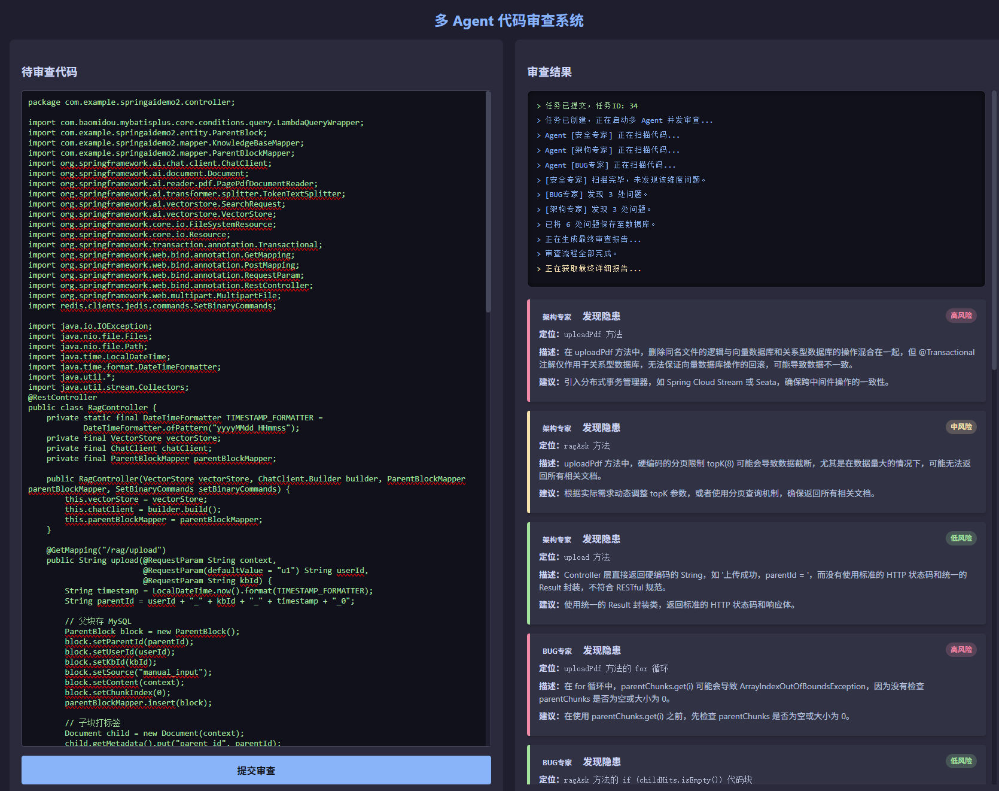
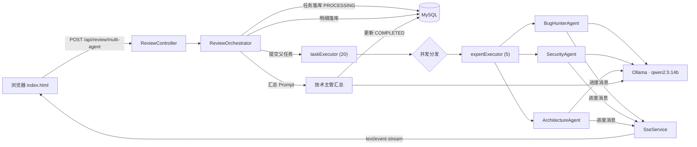

# Code Agent · 多 Agent 代码审查平台

<p>
  
  
  
  
  
</p>

把一段 Java 代码丢进去，**三个不同角色的 AI 专家并发审查**，前端通过 SSE 实时看到每个专家的进度，最后产出一份按风险等级分级的 Markdown 审查报告。


---

## 为什么做这个

直接让大模型「审一遍代码」，常见的结果是什么都提一点、什么都提不深。

这个项目把审查拆成三个**专精角色**，每个角色只关注一个维度，互不干扰；再由一个「技术主管」角色把三份结果汇总成报告。这更接近真实团队做 Code Review 的分工方式，也让每个 Prompt 可以写得很具体。

| 角色 | 关注点 |
| --- | --- |
| `BUG_HUNTER` | 空指针、数组越界、自动拆箱、资源泄漏、魔法值、线程安全 |
| `SECURITY` | SQL 注入、XSS、越权、硬编码密码、敏感信息落日志 |
| `ARCHITECT` | 跨中间件的数据一致性、批量操作与 OOM 隐患、接口契约与 RESTful 规范 |

## 功能特性

- **三角色并发审查**：基于接口 `ExpertAgent` 抽象，新增审查维度只需加一个实现类，主流程零改动。
- **异步任务 + 实时进度**：提交即返回 `taskId`，后台线程池执行，SSE 推送每个 Agent 的状态变化。
- **结构化输出**：用 `ChatClient.entity()` 把模型输出直接映射为对象，不依赖正则或字符串切割解析 JSON。
- **结果持久化**：任务主表 `review_task` + 问题明细表 `review_issue`，支持按 `taskId` 回查完整报告。
- **状态兜底**：任务状态机 `PROCESSING → COMPLETED / FAILED`，异常时不会永久卡在 `PROCESSING`。

## 架构



### 一次审查的完整链路

1. 前端 `POST /api/review/multi-agent`，请求体就是待审查的代码原文。
2. 后端立刻插入一条 `review_task`（`PROCESSING`），把 `taskId` 返回给前端 —— **不阻塞请求**。
3. 任务被提交到调度线程池，`ReviewOrchestrator` 再把三个专家分发给专家线程池并发执行。
4. 每个专家调用一次模型，结果反序列化成 `AgentReviewResult`，同时往前端推一条进度消息。
5. 三个专家全部结束后，问题明细批量写入 `review_issue`。
6. 汇总阶段再调一次模型，把明细整理成 Markdown 报告，回写 `final_report` 并把状态置为 `COMPLETED`。
7. 前端收到「审查流程全部完成」后，调用 `/detail/{taskId}` 拉取明细与报告并渲染。

## 技术栈

| 层次 | 选型 |
| --- | --- |
| 语言 | Java 21 |
| 框架 | Spring Boot 4.1、Spring MVC |
| AI | Spring AI 2.0、Ollama（qwen2.5:14b）、ChatClient / 结构化输出 |
| 持久层 | MyBatis-Plus 3.5 |
| 数据库 | MySQL 8 |
| 实时通信 | SSE（`SseEmitter`） |
| 前端 | 原生 HTML + JS（无构建） |

## 快速开始

### 1. 环境要求

- JDK 21+
- MySQL 8
- [Ollama](https://ollama.com/)（本地跑模型，不依赖任何云端 API Key）

### 2. 拉模型

```bash
ollama pull qwen2.5:14b
ollama serve        # 默认监听 http://localhost:11434
```

> 显存不足 12G 时把 `OLLAMA_CHAT_MODEL` 换成 `qwen2.5:7b` 或 `qwen2.5:3b`，其余不用改。

### 3. 建库建表

方式一，用 Docker（推荐）：

```bash
docker compose up -d mysql
```

`docs/schema.sql` 会在容器首次启动时自动执行。

方式二，手动：

```bash
mysql -uroot -p < docs/schema.sql
```

### 4. 配置数据库密码

复制模板并填入你自己的值：

```bash
cp .env.example .env
```

Windows PowerShell：

```powershell
Copy-Item .env.example .env
```

项目启动时会自动读取根目录的 `.env`（见 `application.yml` 里的 `spring.config.import`），无需额外配置。

> `.env` 已加入 `.gitignore`，不会被提交。 **不要把真实密码写进 `application.yml`。**
> 也可以直接用系统环境变量（`DB_PASSWORD=xxx`），优先级高于 `.env`。

### 5. 启动

```bash
# Linux / macOS
./mvnw spring-boot:run

# Windows
mvnw.cmd spring-boot:run
```

浏览器打开 <http://localhost:8080>，粘贴一段 Java 代码，点「提交审查」。

## 配置项

所有配置均可通过环境变量覆盖，默认值见 `src/main/resources/application.yml`。

| 环境变量 | 默认值 | 说明 |
| --- | --- | --- |
| `SERVER_PORT` | `8080` | 服务端口 |
| `DB_URL` | `jdbc:mysql://localhost:3306/code_agent_db?...` | JDBC 连接串 |
| `DB_USERNAME` | `root` | 数据库用户 |
| `DB_PASSWORD` | 空 | 数据库密码（无默认值，必须提供） |
| `OLLAMA_BASE_URL` | `http://localhost:11434` | Ollama 地址 |
| `OLLAMA_CHAT_MODEL` | `qwen2.5:14b` | 对话模型 |
| `OLLAMA_TEMPERATURE` | `0.2` | 代码审查需要稳定输出，温度不宜高 |
| `OLLAMA_NUM_CTX` | `8192` | 上下文窗口，决定单次可审查的代码长度 |

## 接口说明

### 1. 提交审查任务

```http
POST /api/review/multi-agent?userId=u1&language=java
Content-Type: text/plain

public class Demo { ... }
```

响应：`审查任务已提交，任务ID为：1`

### 2. 订阅实时进度

```http
GET /api/review/stream/{taskId}
Accept: text/event-stream
```

事件内容为纯文本进度，例如：

```
data: 已加载 3 个专家
data: Agent [BUG_HUNTER] 正在扫描代码...
data: [SECURITY] 发现 2 处问题。
data: 审查流程全部完成。
```

### 3. 查询审查结果

```http
GET /api/review/detail/{taskId}
```

```json
{
  "taskInfo": {
    "id": 1,
    "status": "COMPLETED",
    "finalReport": "# 代码审查报告\n..."
  },
  "issueList": [
    {
      "agentRole": "SECURITY",
      "riskLevel": "高",
      "location": "login() 方法",
      "description": "SQL 使用字符串拼接，存在注入风险",
      "suggestion": "改用参数化查询或 MyBatis #{}"
    }
  ]
}
```

## 设计说明

### 为什么用两套线程池

如果父任务和子任务共用一个线程池，父任务占用线程后等待子任务，而队列里排着的子任务又拿不到线程，就会出现**线程饥饿**（严重时表现为"任务永远不结束"）。

所以拆成两层：

- `taskExecutor`（20 线程）：只负责接收请求和整体流程编排，不干重活；
- `expertExecutor`（5 线程）：只负责调用模型。

专家池刻意开得很小，是因为本地 14B 模型的显存决定了并发上限 —— 并发数大于显存能撑住的请求数时，Ollama 会排队甚至 OOM，反而更慢。

### 为什么用 `ChatClient.entity()`

小模型输出 JSON 时经常带 Markdown 代码块、前后废话、字段缺失或多余字段。用 `entity(AgentReviewResult.class)` 交给框架做反序列化，比自己写正则提取 `<json>...</json>` 稳得多，也省掉了一整层容错代码。

### 为什么用 SSE 而不是 WebSocket

这是一条**单向**的进度流：服务端推、前端收，不需要双工。SSE 直接用 HTTP，不需要额外的握手协议和心跳保活，`SseEmitter` 几行就能实现，前端用原生 `EventSource` 也不需要任何库。

## 已知限制 / Roadmap

- [ ] **代码长度未做切分**：目前整段代码一次性进 Prompt，超过 `OLLAMA_NUM_CTX` 会失败。下一步做文件切块 + 向量检索（RAG），让 Agent 只取相关片段。
- [ ] **SSE 断线不重连**：页面刷新后已推送的进度丢失，后续可加分片 id 与事件回放。
- [ ] **无鉴权与限流**：`userId` 目前是查询参数，任何人都能调用，仅适合本地演示。
- [ ] **单机部署**：线程池与任务状态都在单进程内，未做分布式改造。
- [ ] 问题明细逐条插入，量大时可改为批量写入。

## 项目结构

```
Code-Agent
├── src/main/java/com/example/codeagent
│   ├── agent
│   │   ├── ExpertAgent.java            # 专家抽象：角色名 + 审查
│   │   ├── ReviewOrchestrator.java     # 调度、线程池、落库、汇总
│   │   ├── SseService.java             # SSE 连接与消息推送
│   │   ├── model/AgentReviewResult.java
│   │   └── worker                      # 三个专家实现
│   ├── controller/ReviewController.java
│   ├── entity                            # ReviewTask / ReviewIssue
│   └── mapper                            # MyBatis-Plus Mapper
├── src/main/resources
│   ├── application.yml
│   └── static/index.html                 # 单页前端
├── docs/schema.sql
├── docker-compose.yml
└── .env.example
```

## License

MIT
